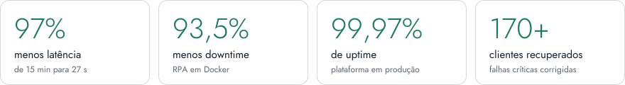

<picture>
  <source media="(prefers-color-scheme: dark)" srcset="assets/banner-dark.svg">
  
</picture>

**Desenvolvedor backend focado em automação inteligente e agentes de IA**

[Portfólio](https://jonasaaugusto.github.io) · [LinkedIn](https://www.linkedin.com/in/jonasaaugusto) · [Currículo (PDF)](https://jonasaaugusto.github.io/JonasAugusto_cv_m.pdf) · [E-mail](mailto:jonasaugustoprofissional@gmail.com) · Augustus AI Solutions <!-- TODO: link -->

## Sobre

Trabalho com backend e agentes de IA com LLMs (OpenAI, Anthropic, DeepSeek), integrando APIs complexas e otimizando latência crítica.
Meu foco é confiabilidade em produção: retry patterns, fallback, monitoramento e observabilidade.
Engenharia de Software na Estácio (CR 9,3, formatura em dez/2026) · inglês C1.

## Em produção

<picture>
  <source media="(prefers-color-scheme: dark)" srcset="assets/metrics-dark.svg">
  
</picture>

## Caso de estudo · F5 Tecnologia

> [!NOTE]
> Plataforma autônoma de conversão de leads com IA, em produção 24/7. Recebe leads pelo WhatsApp, conduz o atendimento com um agente de IA, coleta dados, gera propostas com um parceiro financeiro e cadastra clientes em programas do setor de energia. Atuei de ponta a ponta: arquitetura, agente, integrações e confiabilidade.

- Agente de IA com fallback, prompts por etapa, contexto isolado por lead e guardrails anti-alucinação.
- Pipeline de OCR para documentos e máquina de estados de 9 etapas com persistência por lead.
- Arquitetura distribuída: automação de navegador (Playwright) isolada do agente e da orquestração.
- Servidor MCP criado do zero: o funil vira ferramentas que o agente chama no próprio turno, e a finalização só executa com confirmação explícita validada no código.

[Ver o caso completo no portfólio →](https://jonasaaugusto.github.io/#experiencia)

## Projetos

| Projeto | O que faz | Stack |
| :-- | :-- | :-- |
| [**IAprovale**](https://github.com/JonasaAugusto/IAprovale) | Buscador de concursos com IA: traduz a busca em linguagem natural via DeepSeek e consulta a fonte oficial por MCP. | `Python` `FastAPI` `DeepSeek` `MCP` |
| [**LogiTrack API**](https://github.com/JonasaAugusto/logitrackAPI) | API RESTful de logística com rastreamento em tempo real, relatórios assíncronos e JWT. | `Python` `FastAPI` `PostgreSQL` `Docker` |
| [**NotaME**](https://github.com/JonasaAugusto/NotaME) | App mobile/desktop para recibos em PDF, NFS-e e gestão de clientes; offline-first com sincronização P2P e AES-256. | `C#` `.NET MAUI` `SQLite` |
| [**Fabula Coop**](https://github.com/JonasaAugusto/FabulaCoop) | RPG de texto cooperativo em tempo real em que uma IA atua como mestre da campanha. | `Python` `LLM` `Realtime` |
| [**Pocket Infra**](https://github.com/JonasaAugusto/pocket-infra) | Liga um PC Windows remotamente (Wake-on-LAN) e inicia sessões de Claude Code via adesivo NFC. | `Tailscale` `iOS Shortcuts` `NFC` |
| **VoxAI** (privado) | Transcrição offline de áudio e vídeo com Whisper on-device, sem custo de servidor. | `C#` `.NET MAUI` `Whisper` `FFmpeg` |

> [!TIP]
> **Freelance e Augustus AI Solutions:** agente de IA no WhatsApp (DuTony Hotburguers) e landing pages (Monobloco, Dário Fretes).

## Stack

<picture>
  <source media="(prefers-color-scheme: dark)" srcset="assets/stack-dark.svg">
  
</picture>

## Linguagens

<picture>
  <source media="(prefers-color-scheme: dark)" srcset="assets/langs-dark.svg">
  
</picture>

Soma dos bytes de código dos meus repositórios, públicos e privados.

## Experiência

| Período | Cargo · Empresa |
| :-- | :-- |
| mai/2026 – atual | **Estagiário em Desenvolvimento e Automação** · F5 Tecnologia. Agentes de IA para venda de produtos digitais (crédito e energia), com dados sensíveis conforme a LGPD. |
| set–nov/2025 | **Estagiário de Automação de Processos e Suporte RPA** · NeuroDev |
| ago–set/2025 | **Desenvolvedor Júnior de Automação de Processos com IA** · BNECT |
| ago–set/2023 | **Analista de Requisitos de Software** · Volpatto Engenharia e Arquitetura (freelance) |

## Formação

- **Engenharia de Software** · Universidade Estácio de Sá · 2023 – dez/2026 · CR 9,3
- **Técnico em Desenvolvimento de Software** · SENAI Juiz de Fora · concluído em 2023 · CR 8,0

## Atualmente

- Evoluindo o IAprovale: cliente web e expansão da camada MCP.
- Construindo o VoxAI: transcrição 100% offline com Whisper on-device.
- Estudando FastAPI Avançado + TDD e AWS Cloud Practitioner.

---

Juiz de Fora, MG · [jonasaugustoprofissional@gmail.com](mailto:jonasaugustoprofissional@gmail.com)

*Backend developer focused on AI agents and automation. Portfolio and case study in English at [jonasaaugusto.github.io](https://jonasaaugusto.github.io).*

