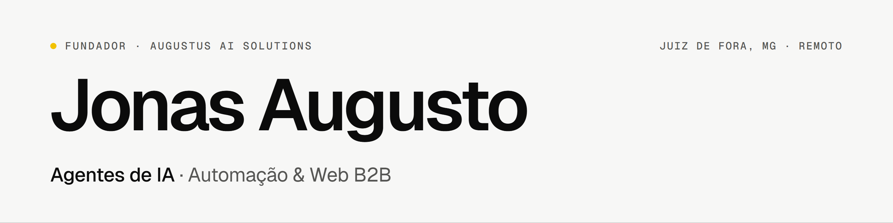

<picture>
  <source media="(prefers-color-scheme: dark)" srcset="assets/banner-dark.png">
  
</picture>

**Fundador da Augustus AI Solutions · Agentes de IA, Automação e Web B2B**

[Portfólio](https://jonasaaugusto.github.io) · [LinkedIn](https://www.linkedin.com/in/jonasaaugusto) · [Currículo (PDF)](https://jonasaaugusto.github.io/JonasAugusto_cv_m.pdf) · [E-mail](mailto:jonasaugustoprofissional@gmail.com) · Augustus AI Solutions

## Sobre

Sou fundador da **Augustus AI Solutions**, onde atuo como CEO e desenvolvedor principal desde jun/2026, de forma remota. A empresa constrói agentes de IA, automações e soluções web para negócios (B2B).
Tenho pouco mais de 1 ano de experiência profissional em estágio e freelancer, e hoje entrego bots de atendimento e vendas no WhatsApp e as ferramentas internas que os sustentam.
Engenharia de Software na Estácio (CR 9,3, formatura em dez/2026) · inglês C1.

## Projetos

| Projeto | O que faz e decisão central | Stack |
| :-- | :-- | :-- |
| **AugustusApp** (repositório privado) · v1.4.1 | App desktop interno que roda a **Clara transcritora** local (WhisperX large-v3 + pyannote + resumo por LLM no Ollama) com **custo de API zero**; numa GPU de 8 GB, o `GpuLease` garante um dono por vez da VRAM. A aba **Bots** opera os robôs de WhatsApp numa VPS por túnel SSH e `bots-api` (sino de avisos, toggles, vários números por bot em slots), e há aba **Gastos** e terminal da VM com eco preditivo. | `C#` `.NET 10` `MAUI` `Python` `WhisperX` `Ollama` `SSH.NET` |
| **Conector WhatsApp** (repositório privado) | Núcleo independente em Baileys, exposto por HTTP/WS, que conecta e desconecta cada bot por QR Code. Decisão: construir o conector próprio em vez de usar o OpenClaw, que gera rastro de automação para a Meta. | `Python` `FastAPI` `Baileys` |
| **Robô de atendimento da Raízes & Escamas** (cliente) | Vendas por WhatsApp para uma loja de aquarismo: RAG com 430 entradas, cadastro em lote pelo grupo do dono (texto, áudio e foto), guarda de quantidades no orçamento, PIX e pós-venda com triagem. A **autoedição de configuração** pelo WhatsApp usa lista branca de campos e confirmação, então o modelo nunca altera preço, PIX ou segurança. Roda como serviço na VPS. | `TypeScript` `Baileys` `DeepSeek` `RAG` `systemd` |
| [**IAprovale**](https://github.com/JonasaAugusto/IAprovale) | Buscador de concursos com IA: traduz a busca em linguagem natural via DeepSeek e consulta a fonte oficial por MCP. Em 24/10/2026 a API saiu do Render para a VPS atrás do Caddy, com HTTPS Let's Encrypt automático, sem cold start e com o banco no backup. | `Python` `FastAPI` `DeepSeek` `MCP` `Caddy` |
| **Infraestrutura** | VPS isolada por usuário Linux (um por projeto, sem shell), cada robô como serviço `systemd`, API dos bots só em loopback e backup diário com restic para o Backblaze B2. Segurança: redação de segredos nos logs e varredura com gitleaks. Decisão: bancos internos na VPS, sem Supabase, para tudo entrar no backup. | `Linux` `systemd` `restic` `Backblaze B2` `gitleaks` |

## Stack

<picture>
  <source media="(prefers-color-scheme: dark)" srcset="assets/stack-dark.svg">
  
</picture>

## Linguagens

<picture>
  <source media="(prefers-color-scheme: dark)" srcset="assets/langs-dark.svg">
  
</picture>

Soma dos bytes de código dos meus repositórios, públicos e privados.

## Experiência

| Período | Cargo · Empresa |
| :-- | :-- |
| jun/2026 – atual | **Fundador, CEO e Desenvolvedor Principal** · Augustus AI Solutions (remoto). Agentes de IA, automação e web B2B. |
| set–nov/2025 | **Estagiário de Automação de Processos e Suporte RPA** · NeuroDev |
| ago–set/2025 | **Desenvolvedor Júnior de Automação de Processos com IA** · BNECT |

## Formação

- **Engenharia de Software** · Universidade Estácio de Sá · 2023 – dez/2026 · CR 9,3
- **Técnico em Desenvolvimento de Software** · SENAI Juiz de Fora · concluído em 2023 · CR 8,0

## Atualmente

- Evoluindo o AugustusApp e os bots de WhatsApp em produção na VPS.
- Mantendo o IAprovale (agora na VPS) e o Conector WhatsApp.

---

Juiz de Fora, MG · [jonasaugustoprofissional@gmail.com](mailto:jonasaugustoprofissional@gmail.com)

*Founder of Augustus AI Solutions, building AI agents, automation and B2B web. Portfolio and case study in English at [jonasaaugusto.github.io](https://jonasaaugusto.github.io).*

