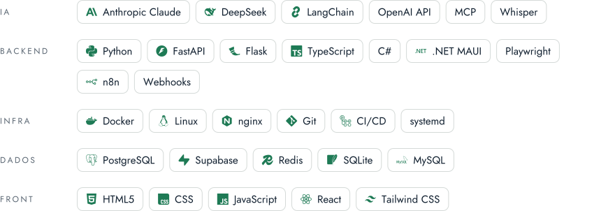
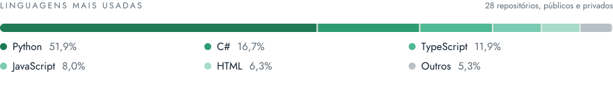

<picture>
  <source media="(prefers-color-scheme: dark)" srcset="assets/banner-dark.svg">
  
</picture>

**Fundador da Augustus AI Solutions · Agentes de IA, Automação e Web B2B**

[Portfólio](https://jonasaaugusto.github.io) · [LinkedIn](https://www.linkedin.com/in/jonasaaugusto) · [Currículo (PDF)](https://jonasaaugusto.github.io/JonasAugusto_cv_m.pdf) · [E-mail](mailto:jonasaugustoprofissional@gmail.com) · Augustus AI Solutions

## Sobre

Sou fundador da **Augustus AI Solutions**, onde atuo como CEO e desenvolvedor principal desde jun/2026, de forma remota. A empresa constrói agentes de IA, automações e soluções web para negócios (B2B).
Tenho pouco mais de 1 ano de experiência profissional em estágio e freelancer, e hoje entrego bots de atendimento e vendas no WhatsApp e as ferramentas internas que os sustentam.
Engenharia de Software na Estácio (CR 9,3, formatura em dez/2026) · inglês C1.

## Projetos profissionais

| Projeto | O que faz | Stack |
| :-- | :-- | :-- |
| **Raízes & Escamas** (cliente) | Bot de atendimento e vendas no WhatsApp para uma loja de aquarismo: RAG com 430 entradas, cadastro em lote pelo grupo do dono (texto, áudio e foto), guarda de quantidades no orçamento, PIX e pós-venda com triagem. Roda como serviço na VPS própria. | `TypeScript` `Baileys` `DeepSeek` `RAG` `systemd` |
| **F5 Tecnologia** (caso abaixo) | Plataforma autônoma de conversão de leads com IA pelo WhatsApp. | `TypeScript` `Baileys` `DeepSeek` `PostgreSQL` |
| **Monobloco** (cliente) | Landing page comercial sob demanda, com foco em conversão e apresentação de produto/serviço. Publicada em produção. | `Landing page` `Web` |

## Caso de estudo · F5 Tecnologia

> [!NOTE]
> Plataforma de relacionamento e automação de pós-venda para uma operação de TV por assinatura: um agente de IA no WhatsApp (boas-vindas, jornada de benefícios, briefing diário e alertas de cobrança), reformulação do painel CRM e ajustes de cadência na integração com a Blip. Atuei de ponta a ponta, da arquitetura aos testes. Agente validado em sandbox e em stack de homologação (23/10/2026); painel e Blip em produção.

**Arquitetura:** 7 serviços em Docker Compose numa VPS Ubuntu (TypeScript/Node.js 22, Fastify, BullMQ + Redis, PostgreSQL 16 com pgvector, Baileys, DeepSeek com tool calling, Groq Whisper e Python/FastAPI). Deploy por GitHub Actions com revisor obrigatório e sessão do WhatsApp cifrada em AES-256-GCM.

- **Regras antes do modelo:** pedidos de saída, de humano e contestações são detectados de forma determinística; a resposta do modelo ainda passa por guardrails que reprovam valor sem fonte e vazamento de prompt.
- **Thinking por política:** o backend liga o raciocínio só onde compensa (fatura, plano, reclamação, retenção), com custo médio de US$ 0,0007 por turno.
- **RAG com níveis de confiança:** busca híbrida (full-text + vetor); com confiança baixa, o agente confirma com o time em vez de responder.
- **Tabela de envios como fonte da verdade:** cada mensagem proativa é uma linha com chave de deduplicação, e queda ou reprocesso não duplicam nem perdem envios.
- **Proteção do número:** aquecimento gradual, janela de envio, intervalos aleatórios e botão para pausar o agente.
- **Painel e Blip:** o cache vencia antes do próximo pedido e remontava tudo dentro da requisição; passou a ser montado em thread fora dela, com leitura incremental e respostas prontas com ETag. Medido em produção (15/10/2026): abrir o painel de 73,7 s para 0,08 s, atualização sem mudança de 4,6 s/1,0 MB para 0,01 s/0 bytes (304), painel fora do ar no reinício de 95 s para 1 s, memória de 268 MB + 410 MB de swap para 264 MB sem swap, e funil da Blip de erro 500 para 0,03 s. Também: conferência com os portais a cada 10 minutos (0 divergências em 1.960 itens) e CRM de conversas da Blip espelhado no painel.
- **Testes:** mais de 750 automatizados, mais de 2.600 casos de fuzz e ataque, e 82 rodadas de jailbreak e prompt injection com 0 falhas.

[Ver o caso completo no portfólio →](https://jonasaaugusto.github.io/#experiencia)

## Projeto principal

**AugustusApp** · app interno da empresa (repositório privado). Reúne em um só lugar:

- transcrição local de reuniões com WhisperX large-v3 e diarização, com resumo por LLM local (Ollama);
- terminal SSH interno da VPS;
- conector de WhatsApp modular e gestão dos bots na VPS;
- administração de backup da VPS com restic para o Backblaze B2;
- publicação versionada do app.

`C#` `.NET 10` `MAUI` `CommunityToolkit.Mvvm` `Python` `WhisperX` `Ollama` `SSH.NET` `xterm.js`

## Mais projetos

| Projeto | O que faz | Stack |
| :-- | :-- | :-- |
| [**IAprovale**](https://github.com/JonasaAugusto/IAprovale) | Buscador de concursos com IA: traduz a busca em linguagem natural via DeepSeek e consulta a fonte oficial por MCP. | `Python` `FastAPI` `DeepSeek` `MCP` |
| [**Conector WhatsApp modular**](https://github.com/JonasaAugusto/whatsappmoduleconnector) · Produto B2B | Serviço que conecta e desconecta bots de WhatsApp por QR Code, cada bot de forma independente. Construído em vez de usar o OpenClaw, que gera rastro de automação para a Meta. | `Python` `FastAPI` `Baileys` |

## Stack

<picture>
  <source media="(prefers-color-scheme: dark)" srcset="assets/stack-dark.svg">
  
</picture>

## Linguagens

<picture>
  <source media="(prefers-color-scheme: dark)" srcset="assets/langs-dark.svg">
  
</picture>

Soma dos bytes de código dos meus repositórios, públicos e privados.

## Experiência

| Período | Cargo · Empresa |
| :-- | :-- |
| jun/2026 – atual | **Fundador, CEO e Desenvolvedor Principal** · Augustus AI Solutions (remoto). Agentes de IA, automação e web B2B. |
| mai/2026 – atual | **Estagiário em Desenvolvimento e Automação** · F5 Tecnologia. Agentes de IA para venda de produtos digitais (crédito e energia), com dados sensíveis conforme a LGPD. |
| set–nov/2025 | **Estagiário de Automação de Processos e Suporte RPA** · NeuroDev |
| ago–set/2025 | **Desenvolvedor Júnior de Automação de Processos com IA** · BNECT |
| ago–set/2023 | **Analista de Requisitos de Software** · Volpatto Engenharia e Arquitetura (freelance) |

## Formação

- **Engenharia de Software** · Universidade Estácio de Sá · 2023 – dez/2026 · CR 9,3
- **Técnico em Desenvolvimento de Software** · SENAI Juiz de Fora · concluído em 2023 · CR 8,0

## Atualmente

- Evoluindo o AugustusApp e os bots de WhatsApp em produção na VPS.
- Mantendo o IAprovale e o Conector WhatsApp modular.

---

Juiz de Fora, MG · [jonasaugustoprofissional@gmail.com](mailto:jonasaugustoprofissional@gmail.com)

*Founder of Augustus AI Solutions, building AI agents, automation and B2B web. Portfolio and case study in English at [jonasaaugusto.github.io](https://jonasaaugusto.github.io).*

